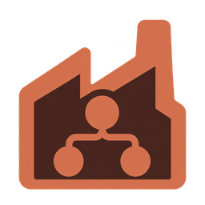

<p align="center">
  
</p>

# Claude Factory

> **Note:** Claude Factory is an unofficial project, not affiliated with or endorsed by Anthropic. "Claude" is a trademark of Anthropic, PBC.

A desktop app (Rust, [Bevy](https://bevyengine.org) + [bevy_egui](https://github.com/vladbat00/bevy_egui)) for defining Claude Code [agent teams](https://code.claude.com/docs/en/agent-teams):
a team's rules and its roster of agents (name, role, model, instructions). The team is sent to Claude as a
prompt at the start of every session, and the app shows which teammates are running.

## Setup

```bash
./install.sh               # installs `claude-factory` in ~/.cargo/bin, plus the desktop entry and icon
```

Then open the app. That's it. `./install.sh` warns if `claude` is not on your PATH.

The desktop entry and the `claude-factory` command run the installed binary, not `target/`: after any change,
run `./install.sh` again and restart the app, or the fix is not what you are running.

The mod is built into the binary. Every time the app starts, it writes the mod to `~/.claude-factory/mod`.
The first time it starts, it also adds two variables to `env` in `~/.claude/settings.json`, after writing a backup
next to that file:

- `CLAUDE_CODE_EXPERIMENTAL_AGENT_TEAMS=1` turns agent teams on.
- `CLAUDE_CODE_PLUGIN_DIRS` gets `~/.claude-factory/mod` added, which loads the `team-factory` mod in every session.
  If an older build added `<this repo>/mod`, that entry is removed.

If setup fails, the status line shows the error and a **Retry Claude setup** button.
Start a new Claude session after that.

## The window

- **Left:** the teams.
- **Middle:** the team view, an animated Bevy scene (`src/scene.rs`). Nodes ease into place and glow by state:
  blue with a spinning ring while starting, green and breathing while working, amber when idle, red when stopped.
  Links carry flowing packets while either end works, and every message (yours or a teammate's) flies along the
  link as an orb that ripples on arrival. Click a node to chat with that agent; scroll to zoom around the cursor
  and drag to move the view.
- **Right:** the Design / Chat panel, then the team's shared task list. Tasks being worked on come first with a
  pulsing dot and who is on them; finished tasks are struck through; blocked ones show what they wait on. A
  working agent's current task is also shown under its node.

Bevy needs a GPU through Vulkan. In a display without one (a nested Xephyr desktop, for instance), run it on
Mesa's software driver: `VK_ICD_FILENAMES=/usr/share/vulkan/icd.d/lvp_icd.json claude-factory`.

## Talk to the agents

Open the **Chat** tab (or click an agent in the team view) and press **Start team**. The app starts one
`claude -p` session per agent, plus a lead (`<team>-lead`), in the team's directory, and streams it over stream-json:

- **Lead** is the default chat: give it the task and it hands work to the teammates by message, follows up and
  reports back. You can still talk to any teammate directly from its own tab.
- Each agent gets the team rules, its own role and instructions, and the names of its teammates as its system prompt.
- Agents message each other with `SendMessage` (cross-session messaging). The app copies every such message into
  the recipient's chat as "From <name>", because Claude's stream never shows messages a session receives.
- **Permissions** sets `--permission-mode` for the team. Nobody can answer a permission prompt in these sessions,
  so anything the mode doesn't allow is denied (`--permission-prompts none`). `auto` is the default.
- Every agent of a team shares one Claude Code task list (`CLAUDE_CODE_TASK_LIST_ID=claude-factory-<team>`, stored
  in `~/.claude/tasks/`). The lead plans the work there, with an owner per task and QA blocked on the developer, and
  teammates mark their task in progress and completed. **Clear** in the task panel empties the list.
- **Stop team**, or closing the app, ends every session. Conversations are not kept across restarts.

Agent names must be unique among the Claude sessions running on this machine, since teammates address each other
by name.

## How it works

| Piece | Role |
|---|---|
| `~/.claude-factory/teams.json` | The teams. The app saves every edit to it right away. |
| `mod/hooks/hooks.json` → `claude-factory session-start` | A SessionStart hook. It picks the enabled team whose **Directory** holds the session's folder most closely (a team with no directory applies everywhere) and adds its prompt to Claude's context, on startup and after `/clear`. |
| `mod/hooks/register.js` | A mod that rewrites `~/.claude-factory/live/<session>.json` with the session's subagents and teammates (`$.agent.list()`) every 2 s and on each spawn. The app reads these files to colour the team view. |

The prompt goes through a settings hook rather than the mod's `prompt.context` event because the built-in
`sec-default` guard skips that event for user-installed mods.

Rebuild with `cargo install --path .` after changing the prompt template (`src/prompt.rs`), since the hook runs
the installed binary.

## License

MIT, see [LICENSE](LICENSE).
